<p align="center">
  
</p>

<p align="center">
  
  
  
  
  
  
  
</p>

<p align="center">
  <b>Pick an activity. Weatherwise searches the next seven days of forecast<br>and tells you the best time to do it, and why.</b>
</p>

<p align="center">
  <a href="#quick-start">Quick start</a> &nbsp;·&nbsp;
  <a href="#what-it-does">Features</a> &nbsp;·&nbsp;
  <a href="#apis-and-credits">APIs</a> &nbsp;·&nbsp;
  <a href="#how-it-is-built">Architecture</a> &nbsp;·&nbsp;
  <a href="#error-handling">Error handling</a> &nbsp;·&nbsp;
  <a href="#deployment">Deployment</a> &nbsp;·&nbsp;
  <a href="#testing">Testing</a> &nbsp;·&nbsp;
  <a href="#security">Security</a>
</p>

<br>

<p align="center">
  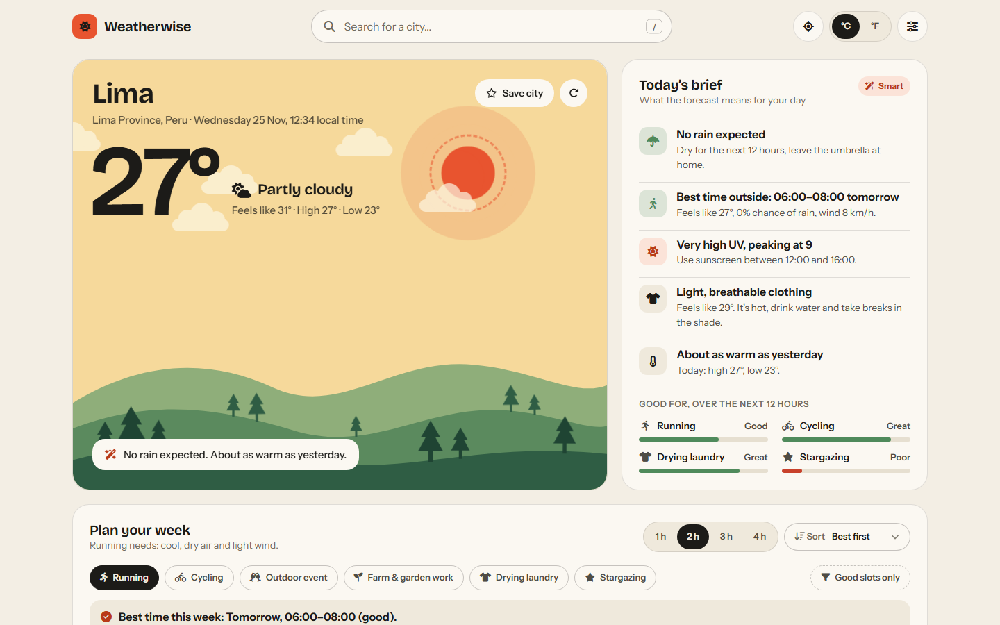
</p>

| | |
| :-- | :-- |
| **Live site** (through the load balancer) | **<https://www.gracemukire.tech/>** |
| Load balancer, direct (Lb01) | <http://35.179.171.101> |
| Web server 1, direct (Web01) | <http://18.132.10.131> |
| Web server 2, direct (Web02) | <http://13.43.219.124> |
| **Demo video** | <https://youtu.be/cxfijRor0g0> |

<br>

## Why it exists

A forecast is a table of numbers. Turning it into a decision takes work.

> A farmer choosing which morning to weed before the heat. A family picking the day
> for an outdoor ceremony. Someone with one free afternoon to wash and dry clothes.
> A runner avoiding rain and strong sun.

Each of them has to scan hour after hour across several days and weigh temperature,
rain, wind, humidity and sun against each other. Weatherwise does that weighing and
gives a straight answer:

> **Best time this week: Monday, 12:00 to 14:00.**

**Who it is for:** anyone whose plans depend on the weather. Outdoor workers and
smallholder farmers, event organisers, athletes, and households planning chores.

<br>

## Quick start

You need [Node.js](https://nodejs.org/) 18 or newer.

```bash
git clone <this-repository-url>
cd smart-weather-dashboard
npm install
npm start
```

Open **<http://localhost:3000>**. That is all.

| Command | What it does |
| :-- | :-- |
| `npm start` | Runs the Express server on port 3000 |
| `npm run dev` | Same, and restarts when `server.js` changes |
| `curl localhost:3000/api/health` | Confirms the server is up |

<details>
<summary><b>Adding an API key</b> (optional)</summary>

<br>

Open-Meteo's free tier needs no key, so this step can be skipped. If a key is used,
it goes in a `.env` file and nowhere else:

```bash
cp .env.example .env
```

```ini
OPEN_METEO_API_KEY=your-key-here
```

Restart the server. It now sends the key with its own requests to Open-Meteo. The
browser still only talks to `/api/...` and never sees the key. `.env` is listed in
`.gitignore`, so it cannot be committed by accident.

</details>

<details>
<summary><b>Running without Node</b></summary>

<br>

Double-clicking `index.html` also works. With no server present, the page falls back
to calling the free, key-less Open-Meteo endpoints itself. This is a convenience for
a quick look, not the way the app is deployed.

</details>

<br>

## What it does

### 1. Plan your week

The core feature. Choose one of six activities and how long it takes. Every possible
slot in the next 7 days is scored out of 100 against what that activity needs, and
the best slot of each day is listed with its conditions.

<p align="center">
  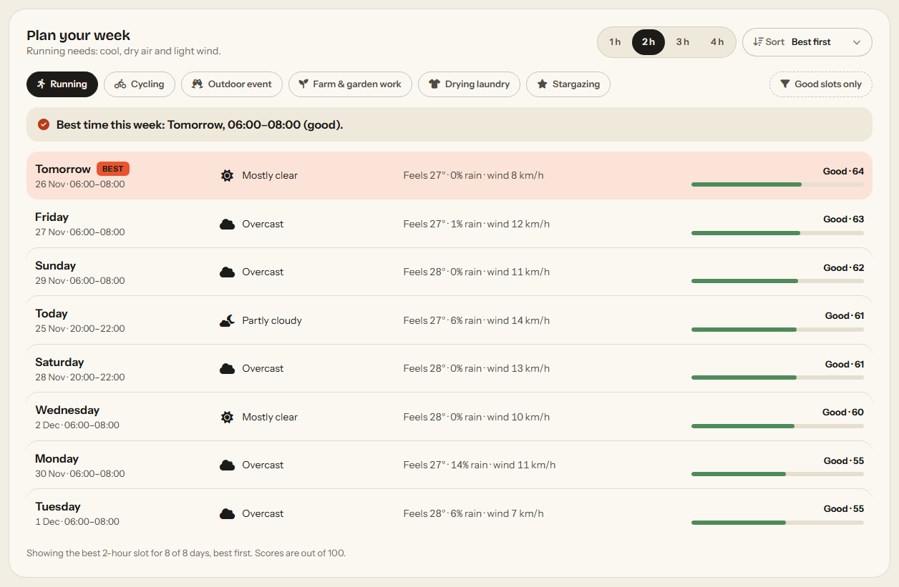
</p>

| Activity | What it looks for | Allowed hours |
| :-- | :-- | :-- |
| Running | Cool, dry air and light wind | 06:00 to 22:00 |
| Cycling | Dry roads and little wind | Daylight |
| Outdoor event | No rain above all, mild and calm | 06:00 to 22:00 |
| Farm and garden work | No heavy heat or strong sun, dry enough to work | Daylight |
| Drying laundry | Dry air, a breeze and no rain | Daylight |
| Stargazing | A dark, cloudless sky | Night |

- **Sort** by best score or by soonest.
- **Filter** to good slots only.
- **Duration** of 1, 2, 3 or 4 hours. One bad hour spoils a slot, so the worst hour
  counts as well as the average.
- **An honest verdict.** When nothing is good, it says so and names the least bad
  option instead of pretending.

### 2. The sky, drawn live

The scene behind the current weather follows the real forecast. The sun and moon
travel between the actual sunrise and sunset for that city, cloud count follows cloud
cover, wind sets how fast clouds drift, and rain, snow, fog and lightning appear when
the forecast says so.

<p align="center">
  
</p>

<p align="center"><sub>Clear day · golden hour · rain · snow · thunderstorm · clear night</sub></p>

### 3. Today's brief

Plain-language advice worked out from the forecast, so nobody has to read a chart to
know what to do:

- when rain is likely, or when it will stop
- the best two-hour window to be outside
- when to wear sunscreen
- what to wear
- how today compares with yesterday
- warnings for strong gusts or polluted air

### 4. Explore the data

<table>
  <tr>
    <td width="50%" valign="top">
      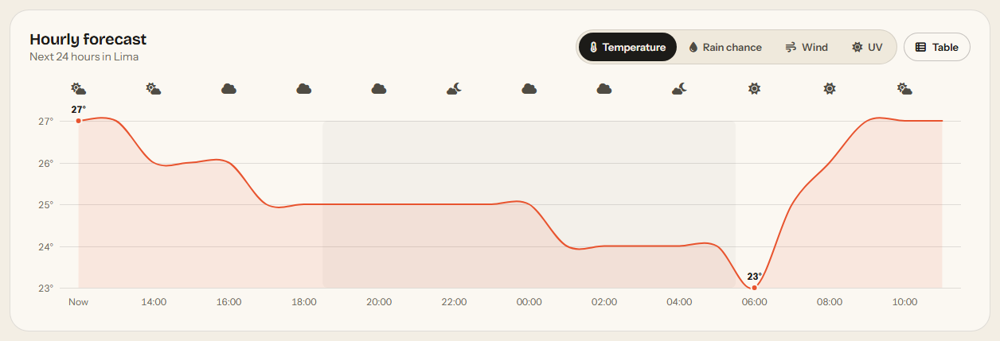
      <p><b>Hourly chart.</b> Switch between temperature, rain chance, wind and UV. Hover, or use the arrow keys, to read any hour. A Table button shows the same data as a table.</p>
    </td>
    <td width="50%" valign="top">
      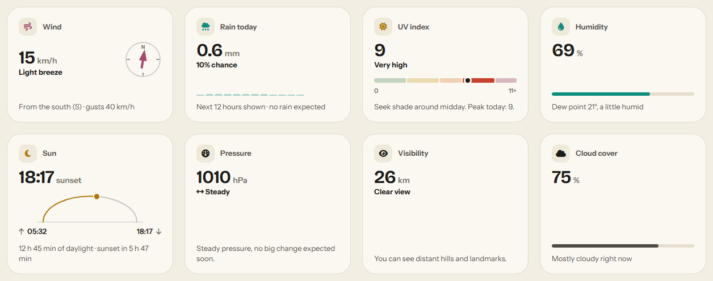
      <p><b>Current conditions.</b> Wind with a compass, rain, UV scale, humidity and dew point, sunrise and sunset, pressure trend, visibility and cloud cover.</p>
    </td>
  </tr>
  <tr>
    <td width="50%" valign="top">
      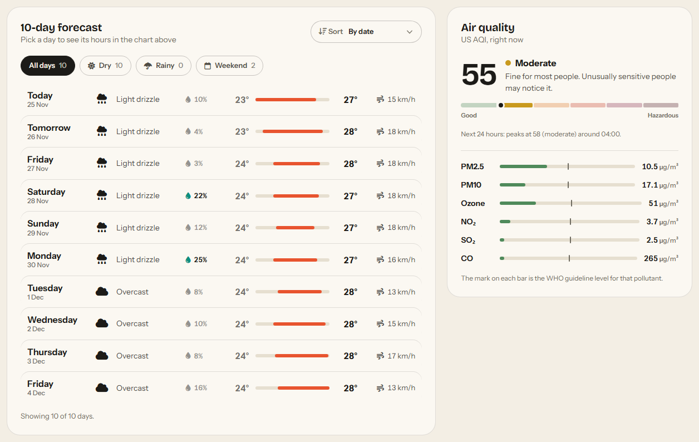
      <p><b>10-day forecast and air quality.</b> Sort days by date, warmest, coolest, wettest, windiest or highest UV. Filter to dry days, rainy days or weekends. Click a day to load its hours into the chart. Air quality shows the US AQI and six pollutants against WHO guideline levels.</p>
    </td>
    <td width="50%" valign="top">
      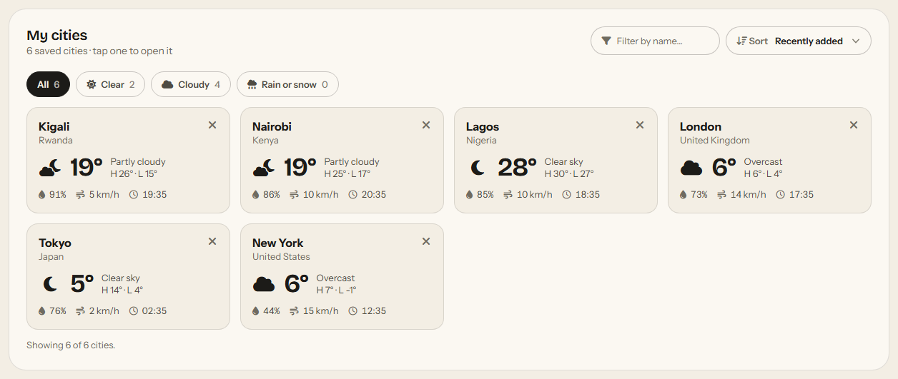
      <p><b>My cities.</b> Save up to 12 cities and compare them side by side. Sort by name, temperature, humidity or wind. Filter by weather. Search the list by name.</p>
    </td>
  </tr>
</table>

### 5. Everything else

| | |
| :-- | :-- |
| **City search** | Suggestions appear after two letters, ranked so the biggest matching city comes first. Recent searches are remembered. |
| **Use my location** | One button shows the weather where you are, with a fallback to your approximate area. |
| **Settings** | Celsius or Fahrenheit, km/h or mph or m/s, 12 or 24 hour clock, light or dark or automatic theme, animation on or off. Saved in the browser. |
| **Keyboard** | <kbd>/</kbd> jumps to search. <kbd>↑</kbd> <kbd>↓</kbd> <kbd>Enter</kbd> <kbd>Esc</kbd> work in the suggestions. <kbd>←</kbd> <kbd>→</kbd> read the chart hour by hour. |
| **Accessibility** | Semantic HTML, ARIA labels, visible focus, a table view for the chart, and respect for the system's reduced-motion and dark-mode settings. |

<p align="center">
  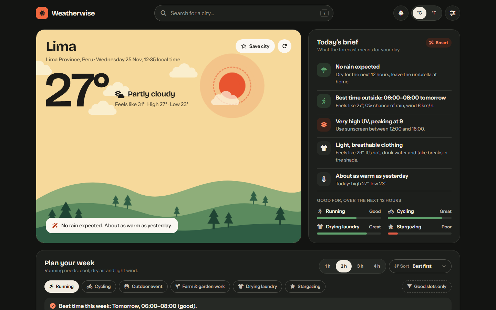
  &nbsp;&nbsp;
  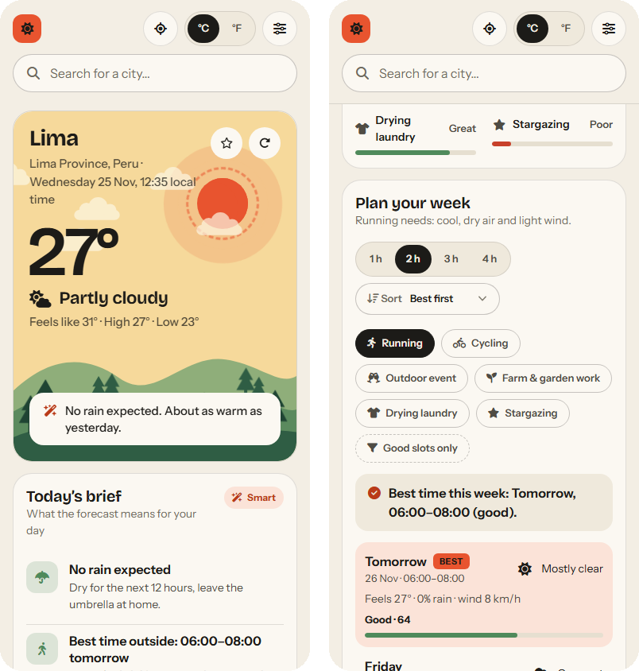
</p>

<p align="center"><sub>Dark theme on desktop · the same app on a phone</sub></p>

<br>

## APIs and credits

The browser never calls Open-Meteo directly. It calls `/api/...` on this project's
Express server, and the server calls Open-Meteo. If a key is set in the server's
`.env` file, the server adds it to its own requests. Either way, **no secret exists
in the front-end code or in the repository.**

| API | Used for | Called by | Docs |
| :-- | :-- | :-- | :-- |
| **Open-Meteo Forecast** | Current, hourly and daily weather. All saved cities in one request. | Server | [open-meteo.com/en/docs](https://open-meteo.com/en/docs) |
| **Open-Meteo Geocoding** | City search (name to coordinates) | Server | [geocoding-api](https://open-meteo.com/en/docs/geocoding-api) |
| **Open-Meteo Air Quality** | US AQI and pollutants | Server | [air-quality-api](https://open-meteo.com/en/docs/air-quality-api) |
| **BigDataCloud Reverse Geocoding** | Coordinates to place name for "Use my location" | Browser | [bigdatacloud.com](https://www.bigdatacloud.com/free-api/free-reverse-geocode-to-city-api) |

BigDataCloud is called from the browser on purpose. Its job is to work out where the
_visitor_ is, and a request sent from the server would locate the server instead. It
needs no key.

**Credits and licences**

- Weather, air-quality and geocoding data by **[Open-Meteo](https://open-meteo.com/)**,
  licensed under [CC BY 4.0](https://creativecommons.org/licenses/by/4.0/). Open-Meteo
  combines models from national weather services, and city names come from
  [GeoNames](https://www.geonames.org/). Thank you to the Open-Meteo team for a free,
  open and well-documented API.
- Reverse geocoding by **[BigDataCloud](https://www.bigdatacloud.com/)**.
- Icons by **[Font Awesome Free 6](https://fontawesome.com/)** (icons CC BY 4.0, fonts
  SIL OFL 1.1, code MIT). Licence file: `assets/vendor/fontawesome/LICENSE.txt`.
- Fonts: **Bricolage Grotesque** by Mathieu Triay and **Instrument Sans** by Rodrigo
  Fuenzalida, both SIL Open Font License 1.1, files obtained via
  [Fontsource](https://fontsource.org/).
- Server packages: [Express](https://expressjs.com/),
  [express-rate-limit](https://github.com/express-rate-limit/express-rate-limit) and
  [dotenv](https://github.com/motdotla/dotenv), all MIT.
- UV and air-quality category names follow the WHO UV index and the US EPA AQI
  scales. Pollutant reference levels are the WHO 2021 air-quality guidelines.
- README badges by [Shields.io](https://shields.io/).

The same data attribution is shown in the footer of the application.

<br>

## How it is built

The front end is plain HTML, CSS and JavaScript with no framework and no build step.
The back end is one Express file. Icons and fonts are stored in the repository, so
the page does not depend on any CDN.

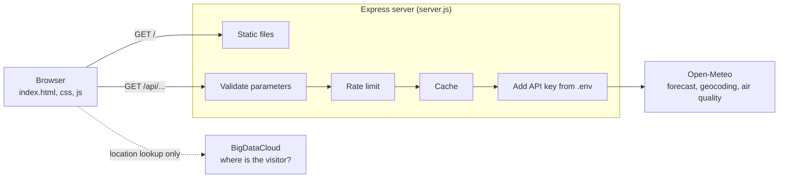

### The server

`server.js` exposes four routes and nothing else.

| Route | Does | Cached |
| :-- | :-- | :-- |
| `GET /api/forecast` | Validates coordinates and variable names, then asks Open-Meteo Forecast | 5 min |
| `GET /api/air-quality` | The same, for Open-Meteo Air Quality | 10 min |
| `GET /api/geocode?name=` | City search through Open-Meteo Geocoding | 24 h |
| `GET /api/health` | Reports that the server is up, and its hostname. Used by the load balancer. | no |

It validates every parameter, limits each visitor to 120 API requests a minute,
caches answers in memory so repeat requests do not reach Open-Meteo again, and turns
upstream failures into clear JSON errors (502 and 504). It only serves `index.html`,
`css/`, `js/` and `assets/`. Requests for `server.js`, `.env` or anything else get a 404.

### Project structure

```
server.js                 Express: serves the site and the /api proxy
package.json              server dependencies
.env.example              template for the server's settings and API key
index.html                page structure (semantic HTML, ARIA)

css/
  base.css                fonts, colour tokens (light and dark), reset
  scene.css               the animated scenery and its colour moods
  components.css          layout and every component

js/
  config.js               API endpoints and settings, the one place to change them
  utils.js                DOM helpers, unit conversion, time formatting
  codes.js                WMO weather code to label, icon and group
  store.js                localStorage: settings, saved cities, forecast cache
  api.js                  all network requests: timeout, retry, validation, errors
  insights.js             the smart brief: forecast to advice and activity scores
  planner.js              the planner: scores every slot in the next 7 days
  scene.js                scenery: sun and moon position, clouds, rain and snow
  chart.js                the hourly SVG chart, tooltip and table view
  search.js               city search (accessible autocomplete)
  render.js               draws the dashboard, including daily sort and filter
  cities.js               the saved cities board: sort, filter, search
  app.js                  state, loading, failure strategy, event wiring

deploy/
  deploy.sh               installs the app on a web server
  weatherwise.init        init script, so the app runs with: service weatherwise start
  nginx/weatherwise.conf  Nginx site for Web01 and Web02
  haproxy/haproxy.cfg     load balancer configuration for Lb01

docs/                     banner and screenshots used in this README
```

### Design decisions

| Decision | Why |
| :-- | :-- |
| **The API is always asked for metric units** | Fahrenheit, mph and inches are converted in the browser, so changing units is instant and costs no request. |
| **City times belong to the city** | Open-Meteo returns local wall-clock times. The app never passes them through the browser's time zone, so Tokyo's forecast shows Tokyo's clock wherever it is opened. |
| **Saved cities use one request** | Open-Meteo accepts a list of coordinates, so the comparison board loads every city in a single call. |
| **API text is never inserted as HTML** | It is only ever added as text nodes, so a response cannot inject markup into the page. |
| **Sorting and filtering run in the browser** | They work on data already loaded, so they are instant and keep working on a slow network. |
| **No chart library** | The chart is about 250 lines of hand-written SVG, which keeps the page small and dependency free. |

<br>

## Error handling

Every browser request goes through one function, `request()` in `js/api.js`, which
adds a 10 second timeout, up to two automatic retries for network errors and 5xx
responses, and validation of the response. The app then degrades in layers, and a
full-page error is the last resort.

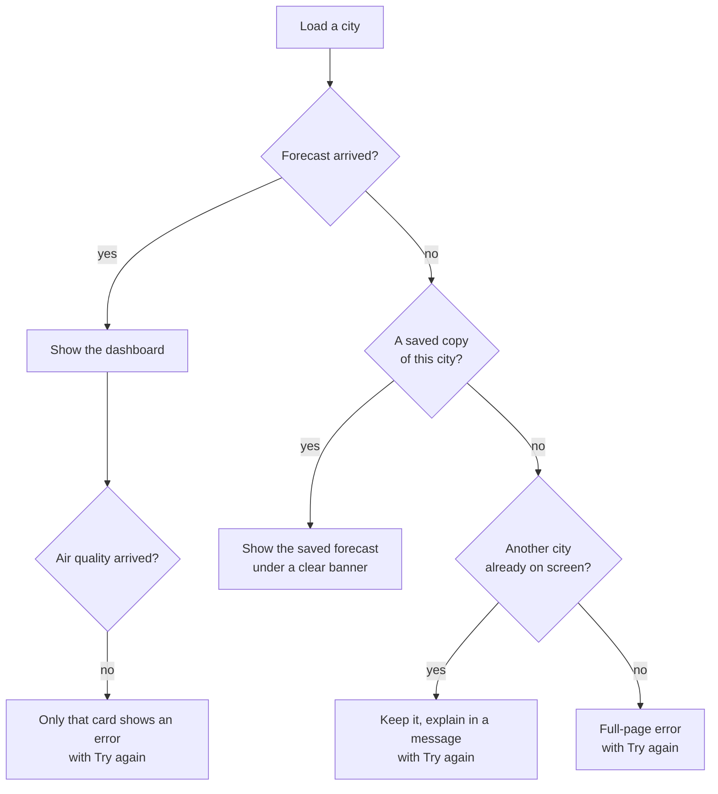

<p align="center">
  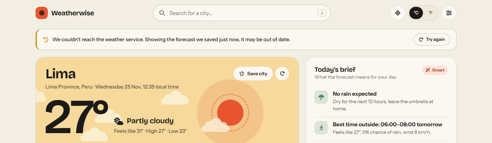
</p>

| Situation | What the user sees |
| :-- | :-- |
| Air-quality API fails | The forecast still loads. The air-quality card explains and offers **Try again**. |
| Forecast fails, city was loaded before | The saved forecast under a banner saying how old it is, with **Try again**. |
| Forecast fails for a newly chosen city | The current city stays on screen. A message explains and offers **Try again**. |
| Nothing can be loaded at all | A full-page message with **Try again** and **Search another city**. |
| No internet connection | An offline banner. When the connection returns, the data refreshes by itself. |
| City search fails | A message inside the search box with **Try again**. |
| No city matches the search | "No places found" with a hint to check the spelling or try a larger city nearby. |
| Saved-cities request fails | That section explains and offers **Try again**. The rest of the page is unaffected. |
| Location denied or unavailable | A message explaining why, and a fallback to the approximate area where possible. |
| API answers with something unexpected | Caught by validation and reported as an unexpected response instead of breaking the page. |
| Too many requests (HTTP 429) | A message asking to wait a minute. |
| A filter matches nothing | An empty state with a button to clear the filter. |

### See the failures on purpose

Add `?fail=` to the address to simulate an outage of one service. This is useful for
testing and for the demo video.

| Address | Simulates |
| :-- | :-- |
| `/?fail=air` | Air quality down |
| `/?fail=forecast` | Forecast down (shows the saved copy if there is one) |
| `/?fail=search` | City search down |
| `/?fail=cities` | Saved-cities board down |
| `/?fail=all` | Everything down |

To see the full-page error, clear the site's storage first so there is no saved
forecast, then open `/?fail=all`.

<br>

## Deployment

Each web server runs the Express server as a `service` on port 3000, with Nginx
in front of it on port 80. HAProxy on Lb01 shares requests between the two.

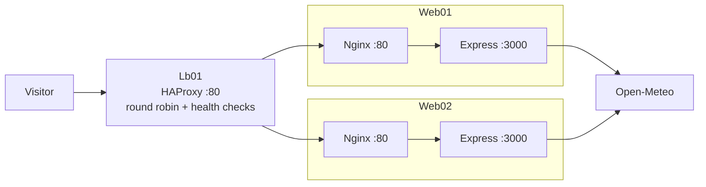

Replace these placeholders with your own values:

| Placeholder | Meaning |
| :-- | :-- |
| `<WEB01_IP>` `<WEB02_IP>` `<LB01_IP>` | The three server addresses |
| `<REPO_URL>` | The HTTPS URL of this GitHub repository |

For the live deployment of this project those values are:

| Server | Address | Role |
| :-- | :-- | :-- |
| Lb01 | `35.179.171.101` (also <https://www.gracemukire.tech/>) | HAProxy load balancer |
| Web01 | `18.132.10.131` | Nginx and Express |
| Web02 | `13.43.219.124` | Nginx and Express |

### Step 1: Web01 and Web02

Run this on Web01, then again on Web02.

```bash
ssh ubuntu@<WEB01_IP>

curl -fsSL https://raw.githubusercontent.com/<user>/<repo>/main/deploy/deploy.sh -o deploy.sh
sudo bash deploy.sh <REPO_URL>
```

What `deploy/deploy.sh` does:

1. Installs Nginx, Git and Node.js 20.
2. Clones the repository to `/var/www/weatherwise`, or pulls the latest commit if it
   is already there, and runs `npm ci`.
3. Creates `/var/www/weatherwise/.env` from `.env.example` if it does not exist,
   readable only by the service user. **This is where an API key goes on the server.**
4. Installs `deploy/weatherwise.init` as `/etc/init.d/weatherwise` and starts the app
   with `service weatherwise restart`. The servers have no systemd, so the app,
   Nginx and HAProxy are all managed with the `service` command.
5. Installs `deploy/nginx/weatherwise.conf` (port 80 to Express) and switches off the
   stock `default` site, which is kept in `sites-available`.
6. Runs `nginx -t`, restarts Nginx and prints a health check.

<details>
<summary><b>The same thing by hand</b></summary>

<br>

```bash
sudo apt-get update && sudo apt-get install -y nginx git curl
curl -fsSL https://deb.nodesource.com/setup_20.x | sudo bash - && sudo apt-get install -y nodejs

sudo git clone <REPO_URL> /var/www/weatherwise
cd /var/www/weatherwise && sudo npm ci --omit=dev
sudo cp .env.example .env && sudo chmod 600 .env
sudo chown -R www-data:www-data /var/www/weatherwise

sudo cp deploy/weatherwise.init /etc/init.d/weatherwise
sudo chmod 755 /etc/init.d/weatherwise
sudo service weatherwise start

sudo cp deploy/nginx/weatherwise.conf /etc/nginx/sites-available/weatherwise
sudo ln -sf /etc/nginx/sites-available/weatherwise /etc/nginx/sites-enabled/weatherwise
sudo rm -f /etc/nginx/sites-enabled/default
sudo nginx -t && sudo service nginx restart
```

</details>

**Check each server directly:**

```bash
curl -sI http://<WEB01_IP>/ | grep -iE "HTTP|x-served-by"
curl -s  http://<WEB01_IP>/api/health
```

Each should answer `HTTP/1.1 200 OK` with its own hostname in `X-Served-By`, and the
health route should return `{"status":"ok","server":"<hostname>", ...}`.

| Task | Command |
| :-- | :-- |
| Is the app running? | `sudo service weatherwise status` |
| Start, stop, restart | `sudo service weatherwise start` (or `stop`, `restart`) |
| Live logs | `sudo tail -f /var/log/weatherwise.log` |
| Set or change a key | `sudo nano /var/www/weatherwise/.env` then `sudo service weatherwise restart` |
| Update after a push | `sudo bash deploy.sh <REPO_URL>` on each web server |

> **After a server reboot.** Without systemd nothing restarts the app on its own, so
> if a server is restarted run `sudo service weatherwise start` and
> `sudo service nginx start` on it. Until then the load balancer's health check keeps
> visitors on the other server.

### Step 2: the load balancer (Lb01)

```bash
ssh ubuntu@<LB01_IP>
sudo apt-get update && sudo apt-get install -y haproxy
sudo nano /etc/haproxy/haproxy.cfg
```

Add the two sections from `deploy/haproxy/haproxy.cfg` to the end of the file, with
the real addresses:

```haproxy
frontend weatherwise_front
    bind *:80
    mode http
    default_backend weatherwise_back

backend weatherwise_back
    mode http
    balance roundrobin
    option httpchk GET /api/health
    http-check expect status 200
    default-server inter 2s fall 3 rise 2
    option forwardfor
    server web-01 <WEB01_IP>:80 check
    server web-02 <WEB02_IP>:80 check
```

```bash
sudo haproxy -c -f /etc/haproxy/haproxy.cfg     # must print "Configuration file is valid"
sudo service haproxy restart
```

| Line | What it does |
| :-- | :-- |
| `balance roundrobin` | Requests alternate: web-01, web-02, web-01, web-02 and so on. |
| `option httpchk GET /api/health` | Every 2 seconds HAProxy asks each server's Express app whether it is alive, so it checks the application itself and not just Nginx. |
| `default-server inter 2s fall 3 rise 2` | A server that fails three checks in a row leaves the rotation and returns after two successful checks, so visitors are never sent to a server that is down. |
| `option forwardfor` | Passes the visitor's real IP address on, which the server uses for rate limiting. |

If Lb01 already has a frontend on port 80 from an earlier task, do not add a second
one. Point the existing frontend at `weatherwise_back`.

> **Note on "Use my location".** Browsers only share precise location on HTTPS pages.
> Over plain `http://` the button still works, but uses the approximate area instead.
> With a domain and a certificate on Lb01, precise location works too.

<br>

## Testing

### Tested locally

Tested in Google Chrome on Windows 11 at desktop (1440 px) and phone (390 px) widths,
in light and dark themes, with the browser console open to confirm there were no
errors.

| Area | What was checked |
| :-- | :-- |
| **Planner** | All six activities and four durations. Sort by best and by soonest. The "good slots only" filter and its empty state. Values follow the unit setting. |
| **Search** | Suggestions appear while typing. Keyboard selection works. The biggest city is listed first ("Lon" gives London). An unknown name shows "No places found". Recent searches are remembered. |
| **Weather display** | Current values, brief, hourly chart, tiles, 10-day list and air quality load for cities in different time zones (Kigali, London, Tokyo, Lima, Loni). |
| **Scenery** | All moods render: clear day, dusk, overcast, rain, snow, storm, fog and clear night. |
| **Chart** | Four measures. Tooltip on hover and with the arrow keys. The table view shows the same 24 hours. |
| **Sorting** | 10-day list by date, warmest, coolest, wettest, windiest and UV. Cities by name, warmest, coolest, humidity and wind. |
| **Filtering** | Days: dry, rainy, weekend, with counts and an empty state. Cities: by weather and by name. |
| **Saved cities** | Save, remove, undo and the 12-city limit. The list survives a page reload. |
| **Units and settings** | Celsius and Fahrenheit, km/h and mph and m/s, 12 and 24 hour, themes, animation off. |
| **Error handling** | Every row of the table in [Error handling](#error-handling), using `?fail=` and the browser's offline mode. |
| **Responsive** | No horizontal scrolling at 390 px. Controls remain reachable. |
| **Express server** | All data loads through `/api`, and the only other host contacted is BigDataCloud. Invalid parameters return 400 and unknown routes 404. Repeat requests are served from cache. `server.js`, `.env`, `package.json`, `README.md` and `deploy/` return 404. |
| **API key handling** | The server was started with a dummy key. It switched to the keyed Open-Meteo endpoints, and the key did not appear in any response, in `/api/health` or in the logs. |
| **Security policy** | The Content-Security-Policy sent by Express is active and the app runs with no violations. |

### Deployment tests

Run these after deploying and keep the output or screenshots as evidence.

**1. Both web servers serve the app**

```bash
curl -sI http://<WEB01_IP>/ | grep -iE "HTTP|x-served-by"
curl -sI http://<WEB02_IP>/ | grep -iE "HTTP|x-served-by"
```

**2. The load balancer alternates between them**

```bash
for i in 1 2 3 4 5 6; do curl -sI http://<LB01_IP>/ | grep -i x-served-by; done
```

Expected output, with the hostname alternating:

```
x-served-by: <web-01-hostname>
x-served-by: <web-02-hostname>
x-served-by: <web-01-hostname>
x-served-by: <web-02-hostname>
```

**3. The site survives one server going down**

```bash
# on Web01 (stopping the app itself also works: sudo service weatherwise stop)
sudo service nginx stop

# from your computer: every answer should now come from web-02, with no errors
for i in 1 2 3 4; do curl -sI http://<LB01_IP>/ | grep -iE "HTTP|x-served-by"; done

# on Web01: bring it back, then repeat test 2. It rejoins within a few seconds.
sudo service nginx start
```

**4. The application works through the load balancer**

Open `http://<LB01_IP>/` in a browser, search for a city, use the planner, sort and
filter the forecast, then open `http://<LB01_IP>/?fail=air` to confirm that error
handling behaves the same as it does locally.

### Deployment evidence

_Fill this in after deploying. Paste command output, or add screenshots to an
`evidence/` folder and link them here._

| Check | Date | Result or evidence |
| :-- | :-- | :-- |
| Web01 serves the app | | |
| Web02 serves the app | | |
| Load balancer alternates (test 2) | | |
| Failover works (test 3) | | |
| App works in the browser through Lb01 | | |

<br>

## Security

| | |
| :-- | :-- |
| **API keys stay on the server** | The browser only calls this app's own `/api` routes. Express reads `OPEN_METEO_API_KEY` from `.env` and attaches it to its outgoing requests. The key is never sent to the browser, never logged, and removed from any upstream error text before that is passed on. |
| **`.env` is never committed** | It is excluded by `.gitignore`, and on the servers it is readable only by the service user. |
| **The proxy is not an open relay** | It can only reach three fixed Open-Meteo endpoints, accepts only validated parameters, and rate-limits each visitor. |
| **Only public files are served** | `server.js`, `.env`, `package.json` and `deploy/` are not reachable from the web. |
| **Content-Security-Policy** | Scripts, styles and fonts load only from the site itself. The browser may only connect to the site and to BigDataCloud. |
| **No HTML injection** | API responses are written to the page as text only. |
| **Input handling** | Search text is trimmed and limited to 80 characters in the browser, then validated again on the server. |
| **Privacy** | Preferences, saved cities and the last forecast stay in the browser's `localStorage`. There is no account, no tracking and no server-side storage. Location is only requested when the location button is pressed. |

<br>

## Challenges and how they were solved

<details open>
<summary><b>Time zones</b></summary>

Open-Meteo returns each city's local time, but JavaScript's `Date` silently converts
to the visitor's time zone, which would show the wrong hours for a city elsewhere.
Solved by treating the API's timestamps as wall-clock values and never passing them
through the browser's own time zone.

</details>

<details>
<summary><b>A slow or failing API should not blank the page</b></summary>

Solved with the layered strategy in [Error handling](#error-handling): independent
requests, a saved copy of the last good forecast, and a full-page error only as the
last resort.

</details>

<details>
<summary><b>Keeping keys out of the browser</b></summary>

Anything a browser can use, a visitor can read. The Express server therefore makes
the Open-Meteo calls itself and adds the key there. To stop that proxy being abused,
it only reaches fixed endpoints, validates every parameter and rate-limits visitors.

</details>

<details>
<summary><b>Rate limiting behind two proxies</b></summary>

Behind HAProxy and Nginx, every request appears to come from the load balancer, so
all visitors would share one rate limit. Express is told to trust two proxy hops,
and both proxies pass on the visitor's real address.

</details>

<details>
<summary><b>Scoring a time slot fairly</b></summary>

Averaging the hours of a slot hides a single hour of heavy rain. The planner mixes
the average with the worst hour, so one bad hour pulls the whole slot down.

</details>

<details>
<summary><b>Search ranking</b></summary>

The geocoding API returned small towns before large cities for short queries ("Lon"
gave Loni before London). Results are re-ranked: exact name matches first, then by
population.

</details>

<details>
<summary><b>Out-of-order responses</b></summary>

When typing quickly or switching cities fast, an older response can arrive after a
newer one and overwrite it. Every new request cancels the previous one with
`AbortController`, and late answers are ignored.

</details>

<details>
<summary><b>Animation without cost</b></summary>

The rain and snow canvas pauses when it is off screen or the tab is hidden, and all
motion is disabled for people who ask their system to reduce it.

</details>

<br>

---

<p align="center">
  <sub>Weather data by <a href="https://open-meteo.com/">Open-Meteo</a> · Location lookup by <a href="https://www.bigdatacloud.com/">BigDataCloud</a> · Icons by <a href="https://fontawesome.com/">Font Awesome</a></sub>
</p>
